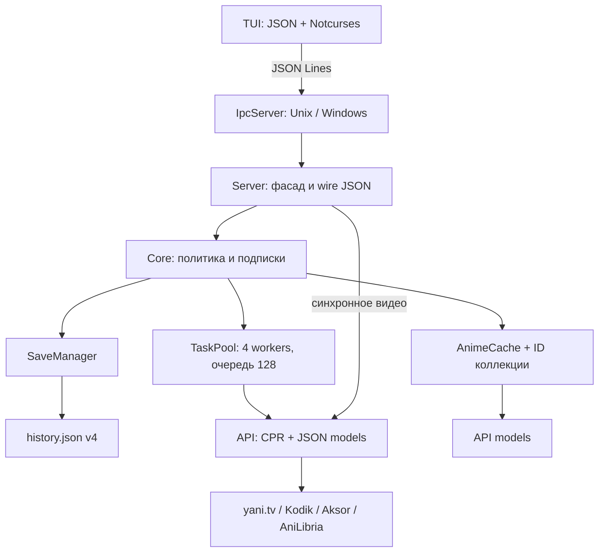

# Архитектурный аудит

> Исторический отчёт до исправлений: строки, hashes и результаты ниже относятся
> к исходному снимку аудита. Последующие изменения и актуальные проверки описаны
> в [REMEDIATION_STATUS.md](REMEDIATION_STATUS.md).

## Фактические зависимости

CMake: `server` включает object-файлы `server_ipc`, `server_ipc` линкует core
и использует объявления Server. Это связь внутри серверного слоя, не цикл
статических библиотек. Циклов между API, Core и Server по исходным include и
целям CMake не обнаружено. TUI не включает backend headers, но имеет лишнюю
зависимость CPR в CMake. Удалять её отдельно от задачи аудита не стали.

## Владение и время жизни

`main`: Core → Server(Core&) → IpcServer(Server&); обратный порядок разрушения
правильный. Core явно вызывает `tasks_.shutdown()` до разрушения своего
состояния. Это существенно: поле `tasks_` объявлено раньше кэша и само по себе
разрушилось бы после него. Удалять явный shutdown опасно.

AnimeCache владеет Entry через `unique_ptr`; выдаёт копии моделей. При
rehash map сами Entry не переезжают. IPC callbacks используют weak_ptr Client,
поэтому не продлевают жизнь соединения бесконечно. Владение socket/pipe
закрывается деструктором Client. Эти решения корректны в обычном пути.

Проблемы остаются в освобождении завершённых Client/thread записей (AUD-006),
остановке блокирующих записей (AUD-003), владении Notcurses при исключении
(AUD-016). Классы с ресурсами и индексами итераторов нельзя бездумно копировать:
например, default-copy `AnimeCollection` скопирует iterators старого списка,
а `IpcClient` — номер fd. Таких копий в текущих сценариях не найдено; это
предупреждение для будущих изменений, не отдельный подтверждённый runtime bug.

## Locks и обратные вызовы

| Объект | Что защищает | Где ограничение нарушается / риск |
| --- | --- | --- |
| `Core::mutex_` | кэш, коллекции, revisions, callbacks | HTTP и callbacks обычно вынесены наружу — хорошо |
| `collection_save_mutex_` | порядок изменений и записи файла | удерживается во время callbacks и nested scheduling, AUD-002 |
| TaskPool mutex / condition variables | очередь и stopping | submit блокируется, в том числе из worker, AUD-024 |
| Client write mutex | fd и последовательность байтов | interrupt ждёт тот же lock, что заблокированный send, AUD-003 |
| stream/collection mutex клиента | активные request IDs | удерживается при send, усиливает backpressure |
| `clients_mutex` | списки соединений и workers | завершённые записи не собираются до stop |

Правило «callback вне mutex Core» недостаточно. Нужен контракт «пользовательский
callback вне всех locks состояния/сохранения» и отдельное упорядочивание событий.
Простая замена mutex на recursive_mutex скроет один симптом, но сохранит
блокирование остальных клиентов и не решит порядок revisions.

Блокирующий send способен удержать API worker. Четыре медленных клиента могут
занять весь пул, после чего очередь заполнится. Нельзя считать bounded queue
полной защитой от перегрузки: число соединений, callbacks и save_data не
ограничены, а часть запросов выполняет HTTP в отдельных client threads.

## Источники истины

- Коллекции ID и save_data — Core; файл — сохранённый снимок. Сейчас успешная
  мутация памяти ошибочно выдаётся за успешное сохранение (AUD-001).
- Карточки — AnimeCache; Search хранит ID, но первый update callback отдаёт
  непосредственно ответ API, а следующий snapshot строится из кэша. При
  отказе обновить full-card получаются разные данные (AUD-008).
- Отсутствующее числовое поле кодируется sentinel, а merge принимает любое
  ненулевое число как известное. Правила несовместимы (AUD-007).
- Полнота карточки не учитывает `need_videos`; metadata-only ответ может
  удовлетворить запрос видео (AUD-009).
- TUI переносит partial merge на полный snapshot. В результате исчезнувшие
  значения остаются на экране (AUD-025).

Нужны точечные изменения контрактов, а не новый слой repository/event bus.
Сначала зафиксировать различие «отсутствует / известный ноль / известное
значение», отдельно свежесть общих полей и полноту details/video. Optional-поля
всей схемы сразу вводить опасно: это затронет wire format и большинство моделей.

## Расширение и сопровождение

VideoExtractor — достаточная небольшая абстракция для iframe-провайдеров.
AniLibria логично отделена, поскольку принимает anime ID, а не iframe.
Реестр можно расширять без изменения Core. HTTP-ответы внешних провайдеров
не проверялись на соответствие живому сервису; regex Kodik зависит от HTML/JS.

Самый заметный источник дублирования — два почти одинаковых IPC dispatcher-а.
Уже возникло расхождение имён helper-функций в Windows (AUD-005). Безопасный
первый шаг — Windows compile check и общие проверки wire-контракта. Выделять
общий dispatcher стоит позже, сохраняя два небольших адаптера транспорта.

`src/api/test.cpp` — не тестовая инфраструктура: это некомпилируемый в целях
дубликат моделей и JSON. Пустые `cmake/Sanitizers.cmake`, `Warnings.cmake`,
`CompilerOptions.cmake` также не включают никаких проверок. Названия файлов
не означают, что соответствующие гарантии уже проверяются.

## Документация и действительность

Описание owning values, версии IPC, статусов и чтения старых форматов в целом
согласовано. Важные исключения: свежие Search-данные могут не обновить full-card;
Search update callback не всегда является проекцией кэша; cold Anime `null`
не проходит путь TUI; HTTP status AniLibria теряется при неуспехе обоих хостов.
Документация уже честно описывает отсутствие error events Search/Feed — это
недостаток контракта, а не вновь обнаруженное нарушение обещания.
